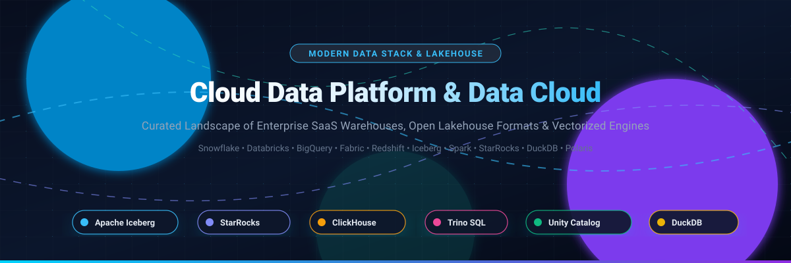

# ⚡ Awesome Cloud Data Platform &amp; Data Cloud 🚀

**Curated ecosystem of Modern Cloud Data Platforms, Lakehouse Architectures, Open Table Formats, Distributed Query Engines &amp; Catalogs** 🌟

*Compare enterprise SaaS data clouds (Snowflake, Databricks, BigQuery, Redshift, Fabric) with open-source lakehouse frameworks (Apache Iceberg, ClickHouse, Apache Spark, DuckDB, Trino, StarRocks).*

[Explore SaaS Platforms](#-saashosted-platforms) • [Open-Source Solutions](#-open-source-github-projects) • [Sector Dynamics](#-sector-overview--market-dynamics) • [Contributing](#-how-to-contribute) • [Support](#-support)

---

## 📖 Overview &amp; Architecture

This repository tracks notable **SaaS platforms** and **open-source projects** in the **Cloud Data Platform &amp; Data Cloud** landscape. These systems enable organizations to ingest, store, govern, and analyze petabyte-scale data—spanning fully managed data platforms with AI-driven optimization to modular, vendor-neutral lakehouse stacks giving teams architectural sovereignty and cost control.

* **Enterprise SaaS Platforms**: Snowflake AI Data Cloud, Databricks Data Intelligence Platform, Google Cloud BigQuery, AWS Redshift, Microsoft Fabric, Oracle ADW, Teradata VantageCloud, SingleStore, Dremio, and Cloudera CDP.
* **Open-Source Lakehouse Stack**: **Apache Iceberg** (de facto open table format standard), **StarRocks**, **ClickHouse**, **Apache Spark**, **DuckDB**, and **Trino** (vectorized and federated query engines), alongside **Apache Polaris**, **Unity Catalog**, and **Lakekeeper** (open data and AI metadata catalogs).

---

## 📑 Table of Contents

- [📊 Sector Overview &amp; Market Dynamics](#-sector-overview--market-dynamics)
- [☁️ SaaS/Hosted Platforms](#-saashosted-platforms)
- [🔓 Open-Source GitHub Projects](#-open-source-github-projects)
- [🤝 How to Contribute](#-how-to-contribute)
- [⭐ Star History](#-star-history)
- [💖 Support](#-support)
- [📜 Disclaimer](#-disclaimer)

---

## 📊 Sector Overview &amp; Market Dynamics

The global Cloud Data Platform market is valued at approximately **$45–50 billion** (expanding at a 17–25% CAGR toward a trillion-dollar cloud computing ecosystem by 2026+), powered by GenAI workloads, open table formats, and decoupled storage-compute architectures. The sector exhibits **moderate-to-high fragmentation**: while foundational compute and storage are anchored by hyperscaler oligopolies (AWS, Microsoft Azure, Google Cloud) and dominant lakehouse platforms (Databricks, Snowflake), the broader landscape remains intensely fragmented across specialized open formats, federated query engines, metadata catalogs, and regional sovereign clouds.

---

## ☁️ SaaS/Hosted Platforms

A comparative overview of enterprise Cloud Data Platforms sorted descending by company scale and valuation:

| 🏢 Platform | 💰 Company Valuation / Revenue Size | 🏷️ Starting Pricing | 🎁 Free Tier / Trial Limit | 🎯 Best For / Key Differentiators |
|:---|:---|:---|:---|:---|
| **[Microsoft Fabric](https://www.microsoft.com/fabric)** | ~$3.88 Trillion (Public Market Cap) | Starting at **$0.18/CU-hour** (Pay-as-you-go F2 tier, ~$262/month; 1-year reserved from ~$154/month) + OneLake storage ($0.023/GB/mo) | **60-day free trial** with access to high-capacity trial SKUs (e.g., F64 equivalent) and 1 TB OneLake storage | Microsoft-centric enterprise ecosystems with heavy Power BI investments seeking unified OneLake SaaS governance. |
| **[Google Cloud BigQuery](https://cloud.google.com/bigquery)** | ~$3.46 Trillion (Alphabet Public Market Cap) | **$6.25 per TiB** scanned (on-demand query pricing); active storage at **$0.020 per GiB/month** | **Always Free Tier**: 1 TiB of query data processed per month and 10 GiB of active storage per month; plus **$300 credit 90-day GCP trial** | Serverless SQL analytics with zero cluster management, integrated BigQuery ML, and BI Engine acceleration. |
| **[AWS Redshift](https://aws.amazon.com/redshift/)** | ~$2.59 Trillion (Amazon Public Market Cap) | Provisioned instances starting at **$0.543/hour** (`dc2.large`); Redshift Serverless starting at **$0.375/RPU-hour** (~$1.50/hour for minimum 4 RPUs) | **$300 credit 90-day trial** for Redshift Serverless; or **2-month free trial** of provisioned `dc2.large` (up to 750 hours/month) | AWS-native ecosystems requiring tight integration with S3, AWS Glue, SageMaker, and Redshift Spectrum. |
| **[Oracle Autonomous Data Warehouse](https://www.oracle.com/autonomous-database/)** | ~$360–430 Billion (Public Market Cap) | Starting at **$0.336 per ECPU/hour** (License Included, min 2 ECPUs = $0.672/hour); BYOL starts at **$0.0807 per ECPU/hour** | **Always Free Tier**: 2 Autonomous Database instances with 1 OCPU / 20 GB storage each; plus **$300 credit 30-day OCI trial** | Oracle shops seeking automated self-tuning, automated patching, zero-maintenance operational lakehouse analytics. |
| **[Databricks Data Intelligence Platform](https://www.databricks.com/)** | ~$190 Billion (Private Valuation) | Serverless / Jobs compute starting at **~$0.07 to $0.15/DBU**; standard compute at **$0.20–$0.40/DBU** (plus underlying cloud VM infrastructure) | **Databricks Free Edition** (forever free serverless environment with daily quota for learning/prototyping); plus **14-day trial with $400 in trial credits** | Code-first engineering and data science teams using Apache Spark, Delta Lake (UniForm), and Unity Catalog. |
| **[Snowflake AI Data Cloud](https://www.snowflake.com/)** | ~$110–115 Billion (Public Market Cap) | Standard Edition starting at **$2.00 per Snowflake Credit** (on-demand compute); cloud storage from **$23/TB/month** | **30-day free trial with $400 in trial credits** (no credit card required upfront) | Fully managed SQL lakehouse/warehouse simplicity, multi-cloud data sharing, and Apache Iceberg (Polaris) support. |
| **[Cloudera Data Platform](https://www.cloudera.com/)** | ~$5.3 Billion (Private Equity Buyout Valuation) | Starting at **$0.04/CCU-hour** (Data Hub) to **$0.07/CCU-hour** (Data Warehouse / Engineering Core rate; all-purpose at $0.20/CCU-hr) | **60-day cloud trial** available via direct Cloudera tenant registration; no self-service always-free tier | Hybrid enterprise architectures with legacy Hadoop/Cloudera estates transitioning to public/private clouds via SDX. |
| **[Teradata VantageCloud](https://www.teradata.com/)** | ~$3.2 Billion (Public Market Cap) | VantageCloud Lake on AWS starting from software usage contracts + AWS compute (~$0.50–$2.00+/node-hr depending on shape) | **Teradata VantageCloud Developer Edition** on AWS Marketplace (free software license up to 2 nodes, pay only EC2/EBS infrastructure costs) | Large-scale enterprises with heavy historical on-premises Teradata migrations requiring high-concurrency complex SQL. |
| **[Dremio](https://www.dremio.com/)** | ~$2.0 Billion (Private Valuation) | Dremio Cloud Standard starting at **$0.20 per DCU** (Dremio Compute Unit, time-based consumption) | **Forever-free Standard tier** (restricted to Small engines and limited users/tables); plus **30-day trial with $400 in trial credits** | Lakehouse query federation on Apache Arrow and direct querying over Amazon S3/ADLS without data duplication. |
| **[SingleStore](https://www.singlestore.com/)** | ~$1.0–1.3 Billion (Private Valuation) | Standard Edition dedicated workspaces starting at **$0.99/hour** (`S-00` tier: 2 vCPU, 16 GB RAM at 0.25 credits/hr; $3.96/credit) | **Always Free Shared Tier** (Helios Shared Edition for developer testing/prototyping); plus **free trial credits** on Standard Edition | Sub-second operational analytics and real-time HTAP ingestion combining transactional and analytical workloads. |

---

## 🔓 Open-Source GitHub Projects

Curated list of open-source table formats, query engines, catalogs, and analytics execution frameworks, ranked descending by GitHub community star popularity:

1. **[ClickHouse](https://github.com/ClickHouse/ClickHouse)**   
   ⚡ **Column-oriented database for real-time analytics** (Apache 2.0) — The fastest open-source engine for single-table aggregation, time-series, and log analytics with vectorized execution. Features MergeTree storage engines, advanced data skipping indices, and sub-second execution across billions of records.

2. **[Apache Spark](https://github.com/apache/spark)**   
   🔥 **Unified analytics engine for large-scale data processing** (Apache 2.0) — The benchmark standard for distributed data pipelines, batch transformations, streaming (Structured Streaming), and machine learning across open lakehouse architectures.

3. **[DuckDB](https://github.com/duckdb/duckdb)**   
   🦆 **In-process SQL OLAP database management system** (MIT) — The "SQLite for analytics", delivering columnar vectorized execution within application runtimes. Directly reads and queries Apache Iceberg, Delta Lake, and Parquet files in S3 and local storage without infrastructure overhead.

4. **[Apache Doris](https://github.com/apache/doris)**   
   🚀 **MPP analytical database** (Apache 2.0) — High-concurrency OLAP engine with native MySQL protocol compatibility, real-time update handling via Unique Key upserts, inverted indexing for full-text search, and lakehouse catalog acceleration.

5. **[Trino](https://github.com/trinodb/trino)**   
   ⚔️ **Distributed SQL query engine for federated analytics** (Apache 2.0) — The industry standard for querying heterogeneous data sources at massive scale without moving data. Connects natively to Apache Iceberg, Delta Lake, Hive, relational databases, Kafka, and NoSQL stores.

6. **[StarRocks](https://github.com/StarRocks/starrocks)**   
   ⭐ **Next-gen sub-second OLAP lakehouse engine** (Apache 2.0, Linux Foundation) — High-performance vectorized query engine featuring asynchronous incremental materialized views with automated rewrite, separation of storage and compute, and multi-catalog lake querying (Iceberg, Delta Lake, Hudi, Paimon).

7. **[Apache Arrow DataFusion](https://github.com/apache/arrow-datafusion)**   
   🏹 **Extensible SQL query engine and execution framework in Rust** (Apache 2.0) — Blazing-fast in-memory columnar query engine utilizing Apache Arrow memory format; powering the next generation of custom data platforms, distributed query engines, and database systems.

8. **[Apache Iceberg](https://github.com/apache/iceberg)**   
   🧊 **Open table format for huge analytic tables** (Apache 2.0) — The de facto open standard for modern lakehouses with vendor-neutral Apache governance. Delivers full ACID transactions, partition evolution, schema evolution, hidden partitioning, and time-travel querying across engines.

9. **[Delta Lake](https://github.com/delta-io/delta)**   
   🔺 **Open-source storage framework for ACID lakehouses** (Apache 2.0) — Storage layer powering lakehouses with transaction logs, schema enforcement, time travel, and UniForm (Universal Format) for cross-format reading across Iceberg and Hudi readers.

10. **[Apache Hudi](https://github.com/apache/hudi)**   
    🌊 **Transactional data lake platform** (Apache 2.0) — Specialized in streaming ingestion, change data capture (CDC), and record-level mutations with Copy-On-Write and Merge-On-Read storage primitives and built-in indexing.

11. **[Apache Pinot](https://github.com/apache/pinot)**   
    🍷 **Real-time distributed OLAP datastore** (Apache 2.0) — Designed for low-latency, user-facing real-time analytics at ultra-high throughput (tens of thousands of QPS), indexing streaming data from Kafka/Kinesis and batch data from S3/HDFS.

12. **[Unity Catalog](https://github.com/unitycatalog/unitycatalog)**   
    🌐 **Open universal catalog for data and AI governance** (Apache 2.0) — Provides unified metadata, data access control, credential vending, and governance across tables (Delta, Iceberg), unstructured files, and AI models.

13. **[Apache Gravitino](https://github.com/apache/gravitino)**   
    🌌 **Federated metadata lakehouse catalog** (Apache 2.0) — Unifies heterogeneous metadata governance across relational databases, open table formats (Iceberg, Hudi), messaging systems (Kafka), and AI assets with centralized security and credential vending.

14. **[Apache Polaris](https://github.com/apache/polaris)**   
    🧭 **Open-source Iceberg REST catalog** (Apache 2.0) — Neutral, multi-engine catalog based on the Apache Iceberg REST specification. Implements centralized RBAC, credential vending for cloud storage, and catalog federation.

15. **[Apache Nessie](https://github.com/projectnessie/nessie)**   
    🌿 **Git-like transactional catalog for Iceberg and Delta** (Apache 2.0) — Brings Git concepts (branches, tags, commits, and merges) to data lakehouse catalogs, facilitating isolated dev/stage/prod environments and data experimentation.

16. **[Lakekeeper](https://github.com/lakekeeper/lakekeeper)**   
    🦀 **Rust-native Iceberg REST catalog** (Apache 2.0) — Ultra-lightweight, high-performance catalog implementing the Iceberg REST standard with access control, multi-tenant workspace separation, and low operational footprint.

---

## 🤝 How to Contribute

Contributions are always welcome! Help keep this curated landscape up to date:

1. 🍴 **Fork** this repository.
2. 📝 **Add/edit** entries in `README.md` following the established tabular or badge list format.
3. 🔍 **Verify**: Include name, link, factual 1–2 sentence description, license (for open-source), and verified pricing/free-tier details.
4. 🚀 **Submit** a pull request with a concise explanation of changes.

---

## 🌟 Star History

---

## 💖 Support

Thank you for visiting and supporting the **Awesome Cloud Data Platform &amp; Data Cloud** project! 🙏

If you found this list helpful, please consider supporting the project:
* ⭐ **Star** this repository on GitHub.
* 🍴 **Fork** and share it with fellow data architects, data engineers, and developers.
* 📢 **Share** on LinkedIn, X/Twitter, or Reddit.
* ☕ **Buy a coffee & sponsor**: Support continuous maintenance and research via the [GitHub Sponsor Dashboard](https://github.com/sponsors/ishandutta2007).

---

## 📜 Disclaimer

- This is a **community-curated** list — not exhaustive and not an endorsement.
- Cloud data platforms handling enterprise data must comply with data protection regulations (GDPR, CCPA, etc.) and implement appropriate access controls, encryption, and audit logging.
- **Platform vs. Engine vs. Format vs. Catalog**: Snowflake, Databricks, BigQuery, Redshift, and Fabric bundle storage, compute, and governance. StarRocks, Trino, ClickHouse, and Doris are query engines. Apache Iceberg, Delta Lake, and Apache Hudi are open table formats. Polaris, Unity Catalog, Gravitino, Nessie, and Lakekeeper are metadata catalogs.
- Pricing and trial limits change periodically. Validate with official vendor pricing documentation prior to architectural deployment.

---

<b>Made with ❤️ for data engineers, platform architects, and developers building modern data platforms.</b>

